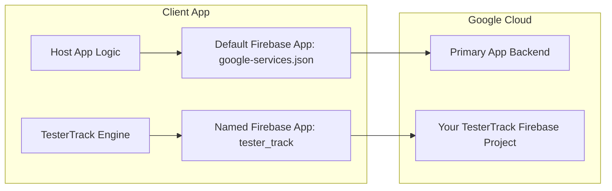
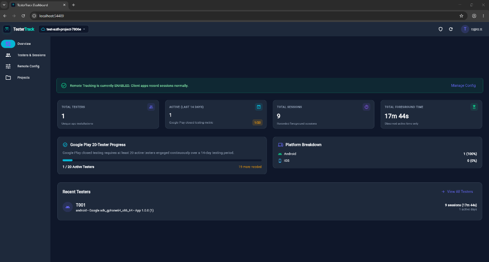

<p align="center">
  
</p>

<p align="center">
  <a href="https://pub.dev/packages/tester_track"></a>
  <a href="https://flutter.dev"></a>
  <a href="https://opensource.org/licenses/MIT"></a>
  <a href="https://firebase.google.com/"></a>
</p>

A lightweight, developer-owned Flutter package for monitoring tester engagement during **Google Play Closed Testing (14-day / 20-tester requirement)** without expensive third-party SaaS tools or backend servers.

All analytics data and remote configuration live strictly inside your own secondary Firebase project.

---

## 📑 Table of Contents

- [Why TesterTrack?](#-why-testertrack)
- [Key Features](#-key-features)
- [How It Works (Secondary Firebase App)](#-how-it-works-secondary-firebase-app)
- [Quick Start Guide](#-quick-start-guide)
  - [1. Add Dependency](#1-add-dependency)
  - [2. Firebase Project Setup](#2-firebase-project-setup)
  - [3. Firestore Security Rules (Optional for Quick Testing)](#3-firestore-security-rules-optional-for-quick-testing)
  - [4. Initialize TesterTrack in Your Flutter App](#4-initialize-testertrack-in-your-flutter-app)
- [Identifying Testers by Email (Post-Login)](#-identifying-testers-by-email-post-login)
- [Companion Web Dashboard](#-companion-web-dashboard)
- [Remote Configuration & Kill Switch](#-remote-configuration--kill-switch)
- [API Reference](#-api-reference)
- [FAQ & Architecture Insights](#-faq--architecture-insights)
- [Privacy & Google Play Compliance](#-privacy--google-play-compliance)
- [License](#-license)

---

## 💡 Why TesterTrack?

To publish new apps on Google Play, Google requires personal developer accounts to run a **closed test with at least 20 testers opted in for 14 continuous days**. 

Traditional analytics tools (like Google Analytics or Mixpanel) are often noisy, complicated to filter for specific QA testers, or take 24–48 hours to process session batches. 

**TesterTrack** solves this with:
- ⏱️ **Real-time daily usage metrics**: See instantly who is active today, their session durations, and overall engagement history.
- 🔒 **100% Developer-Owned**: No subscriptions, no external servers. Data goes directly from the tester's device to your Firebase Firestore database.
- ⚡ **Zero-interference integration**: Runs as a named secondary Firebase App. It never conflicts with your app's existing Firebase setup or `google-services.json`.

---

## ✨ Key Features

- **Accurate Foreground Tracking**: Only observed foreground time is tracked. Background sleep or wall-clock idle time is excluded.
- **Crash & Sudden Exit Recovery**: Automatically recovers interrupted sessions on the next app launch using locally persisted checkpoints.
- **Identify Testers by Email or Installation ID**: Tag testers by their email post-login or use cryptographically generated anonymous installation IDs.
- **Remote Kill-Switch**: Remotely disable tracking once the 14-day testing period ends by updating a Firestore document. No new app release needed!
- **Battery & Network Efficient**: Throttled heartbeats and periodic sync buffers (default: 5 minutes) protect device battery and stay well within Firebase free tier limits.
- **Beautiful Real-Time Web Dashboard**: Built-in Flutter Web dashboard with responsive UI, search, filtering, and export capabilities.

---

## 🏗️ How It Works (Secondary Firebase App)

You **do not** need to download or merge a `google-services.json` or `GoogleService-Info.plist` file into your mobile app!

TesterTrack instantiates an isolated in-memory Firebase App:
```dart
Firebase.initializeApp(
  name: 'tester_track', // Isolated named app
  options: yourTesterTrackFirebaseOptions,
);
```



This guarantees:
1. **Zero collisions**: Your primary Firebase auth, push notifications, and database remain untouched.
2. **Easy plug-and-play**: Simply pass your credentials in Dart code.

---

## 🚀 Quick Start Guide

### 1. Add Dependency

Add `tester_track` to your `pubspec.yaml`:

```yaml
dependencies:
  tester_track: ^0.0.1
```

Or run:
```bash
flutter pub add tester_track
```

---

### 2. Firebase Project Setup

1. Go to the [Firebase Console](https://console.firebase.google.com/) and create a new Firebase project (e.g., `my-app-tester-track`).
2. **Enable Anonymous Authentication**:
   - Go to **Build** > **Authentication** > **Sign-in method**.
   - Enable **Anonymous** provider.
3. **Enable Cloud Firestore**:
   - Go to **Build** > **Firestore Database** > **Create database**.
   - Choose a region near your testers and start in test mode.
4. **Get Firebase Options**:
   - In Project Settings > General > Web Apps, register a web app (or use FlutterFire CLI) to copy your `FirebaseOptions` credentials:
     - `apiKey`
     - `appId`
     - `messagingSenderId`
     - `projectId`
     - `storageBucket`

---

### 3. Firestore Security Rules (Optional for Quick Testing)

> ⚡ **Quick Start (Zero Config)**:  
> If you selected **"Start in test mode"** when creating Firestore, you can **skip this step completely!** The package will work immediately out of the box.

When you are ready for real closed testing (to prevent Firebase's 30-day Test Mode auto-lockout and protect tester data privacy), simply copy and paste the ready-to-use [`firestore.rules`](firestore.rules) file into your Firebase Firestore Rules tab.

*(No custom rule coding required — the rules file is pre-configured and ready to paste).*

---

### 4. Initialize TesterTrack in Your Flutter App

#### Option A: Post-Login Identification with Tester Email (Recommended)
If your app has a login flow and you want testers to appear on your dashboard with their actual email address:

```dart
import 'package:flutter/material.dart';
import 'package:tester_track/tester_track.dart';

const testerTrackOptions = FirebaseOptions(
  apiKey: 'AIzaSy...',
  appId: '1:123456789:web:...',
  messagingSenderId: '123456789',
  projectId: 'my-tester-track-project',
  storageBucket: 'my-tester-track-project.appspot.com',
);

// Call this right after the tester successfully logs in:
Future<void> onUserLoggedIn(String userEmail) async {
  await TesterTrack.initialize(
    firebaseOptions: testerTrackOptions,
    testerId: userEmail, // e.g. 'tester.alex@gmail.com'
  );
}

// In your splash screen or main() if the user is already authenticated:
void restoreSession(String? savedUserEmail) async {
  if (savedUserEmail != null) {
    await TesterTrack.initialize(
      firebaseOptions: testerTrackOptions,
      testerId: savedUserEmail,
    );
  }
}

// When tester logs out:
void onUserLoggedOut() {
  TesterTrack.instance.stopTracking();
}
```

#### Option B: Pre-Login / App-Start Initialization in `main.dart`
If you want to track pre-login startup, onboarding, or unauthenticated apps:

```dart
import 'package:flutter/material.dart';
import 'package:tester_track/tester_track.dart';

void main() async {
  WidgetsFlutterBinding.ensureInitialized();

  await TesterTrack.initialize(
    firebaseOptions: const FirebaseOptions(
      apiKey: 'AIzaSy...',
      appId: '1:123456789:web:...',
      messagingSenderId: '123456789',
      projectId: 'my-tester-track-project',
      storageBucket: 'my-tester-track-project.appspot.com',
    ),
    // Omit testerId to auto-generate a secure anonymous installation ID (e.g. tt_1926b01a_...)
  );

  runApp(const MyApp());
}
```

---

## 👤 Identifying Testers at Runtime (`setTesterId`)

If you initialize `TesterTrack` in `main.dart` anonymously and want to link the tester's email after they complete the login screen:

```dart
// After user signs in:
await TesterTrack.instance.setTesterId('john.doe@company.com');
```

**What happens automatically:**
1. Finalizes the pre-login anonymous session cleanly.
2. Synchronizes the new tester profile under `/testers/john.doe@company.com`.
3. Seamlessly begins tracking all future sessions under the new identity.

When the user logs out:
```dart
await TesterTrack.instance.resetTesterId(); 
// or: TesterTrack.instance.stopTracking();
```

---

## 🖥️ Companion Web Dashboard

<p align="center">
  
</p>

> 🌐 **Live Web Dashboard**: [https://tester-track.pages.dev/](https://tester-track.pages.dev/)

TesterTrack includes an open-source, responsive Flutter Web Dashboard located in the [`dashboard/`](dashboard/) folder.

### Running the Dashboard Locally

```bash
cd dashboard
flutter run -d chrome
```

### Dashboard Features:
- 📊 **Overview KPI Cards**: Total testers, active testers, sessions count, total testing hours.
- 🟢 **Active Today Tracker**: See at a glance which testers opened the app today and their exact time spent.
- 📋 **Tester Detail View**: Breakdown of all individual sessions, duration, device OS, and app version.
- ⚙️ **Remote Config Management**: Flip the global kill switch or adjust sync intervals right from the browser.

---

## 🎛️ Remote Configuration & Kill Switch

TesterTrack features built-in remote configuration managed via Firestore:

**Document Path**: `config/global`

```json
{
  "enabled": true,
  "expiresAt": null,
  "minAppVersion": null,
  "syncIntervalSeconds": 300
}
```

### Remotely Disabling Tracking
When your Google Play 14-day closed testing is complete:
1. Open the Web Dashboard (or your Firebase Console).
2. Set `"enabled": false`.
3. All tester devices will automatically finalize their current session and stop tracking immediately on their next config refresh. **No new app update needed!**

---

## 📚 API Reference

### `TesterTrack`

| Method / Property | Return Type | Description |
|---|---|---|
| `initialize({...})` | `Future<bool>` | Initializes the engine, named Firebase app, and session manager. Safe to call multiple times. |
| `instance` | `TesterTrack` | Singleton instance of `TesterTrack`. |
| `isInitialized` | `bool` | Whether the tracking engine is successfully initialized. |
| `isTracking` | `bool` | Whether a foreground session is currently active. |
| `testerId` | `String?` | The current active tester ID. |
| `setTesterId(String id)` | `Future<bool>` | Updates the active tester identity (e.g. after login), transitions session, and updates Firestore. |
| `resetTesterId()` | `Future<bool>` | Resets tester ID back to an anonymous installation identifier. |
| `startTracking()` | `void` | Manually resumes tracking if permitted. |
| `stopTracking()` | `void` | Manually finalizes active session and stops tracking. |

### `TesterTrackOptions`

```dart
const TesterTrackOptions({
  Duration localHeartbeatInterval = const Duration(seconds: 15),
  Duration firestoreSyncInterval = const Duration(minutes: 5),
  Duration inactivityDebounce = const Duration(seconds: 15),
  bool debugLogging = false,
});
```

---

## ❓ FAQ & Architecture Insights

#### Q: Why don't I need `google-services.json`?
**A:** `google-services.json` is only used by the Google Services Gradle plugin to configure the default `[DEFAULT]` Firebase App. Because TesterTrack initializes an explicitly named secondary app in Dart (`Firebase.initializeApp(name: 'tester_track', options: ...)`), it operates purely from in-memory options without needing native config files.

#### Q: What if a tester loses internet connection?
**A:** TesterTrack uses local device storage (`SharedPreferences`) to buffer active session duration. Once connectivity resumes or on the next sync interval, the accumulated foreground time is synchronized to Firestore.

#### Q: What if the app crashes or the user swipes it away?
**A:** Interrupted sessions are saved at regular local checkpoints. Upon next app launch, TesterTrack automatically recovers the interrupted session and marks it cleanly with the true observed duration.

---

## 🛡️ Privacy & Google Play Compliance

- **No Sensitive Data**: TesterTrack does not access location, contacts, advertising IDs, or camera.
- **Device Information**: Only collects platform OS version, device model, and app package version for QA device compatibility diagnostics.
- **Anonymous Authentication**: Tester devices connect via Firebase Anonymous Auth, requiring no passwords or external OAuth scopes.

---

## 📄 License

This project is licensed under the MIT License - see the [LICENSE](LICENSE) file for details.
